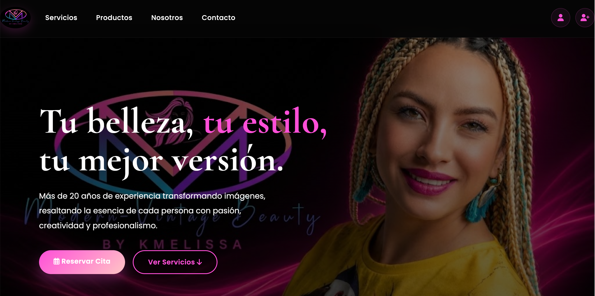
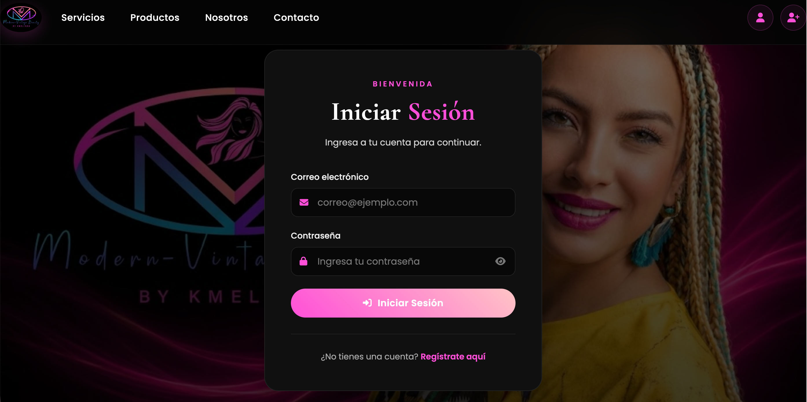

 <div align="center">

# 🌸 Hi, I'm Manuela Muñoz

### Full Stack Web Developer | Frontend Development | Quality Assurance

**Building functional, reliable and user-centered web applications.**

I'm a Web Developer with a background in Quality Assurance, Operations and Customer Support. I specialize in frontend development with Angular and TypeScript, while also working with Node.js, Express and MongoDB to build complete web applications.

My approach combines technical development, software testing, attention to detail and user experience. I enjoy transforming requirements into functional interfaces and making sure applications work as expected, not just look good.


📍 Bogotá, Colombia

[LinkedIn](https://www.linkedin.com/in/manuela-pacheco-munoz-web-developer/) · [GitHub](https://github.com/ellafae) · [Email](mailto:manupa1819@gmail.com)

</div>

---

## 🩷 Technical Skills

### 🎨 Frontend Development

- HTML5 and semantic markup
- CSS3 and responsive web design
- JavaScript (ES6+)
- TypeScript
- Angular 17
- Angular Components, Services and Routing
- Reactive forms and form validation
- Bootstrap 4.6
- Font Awesome
- Chart.js
- REST API integration
- User Interface (UI) implementation
- User Experience (UX) principles
- Responsive layouts and accessibility awareness

### ⚙️ Backend Development

- Node.js
- Express.js
- RESTful API development
- MVC architecture
- CRUD operations
- Middleware implementation
- Session-based authentication
- Role-based access control
- Password hashing with bcrypt
- File uploads with Multer
- Email integration with Nodemailer
- Server-side validation
- HTTP requests and JSON communication

### 🗄️ Databases

- MongoDB
- Mongoose
- Database modeling
- Schema validation
- CRUD operations
- Data relationships and queries
- MongoDB Compass

### 🧪 Quality Assurance & Software Testing

- Unit Testing
- Jasmine
- Karma
- Jest
- Functional Testing
- Test Case Design
- Requirements Analysis
- Bug Identification and Reporting
- Regression Testing
- Frontend Component Testing
- Backend Testing
- API Testing with Postman
- Test Coverage
- Debugging and Troubleshooting
- Edge Case Analysis
- Software Quality Validation

### ☁️ Deployment & Infrastructure

- DigitalOcean
- Debian Linux
- Ubuntu Linux
- Linux Command Line
- SSH and Remote Server Administration
- Node.js Production Environments
- PM2 Process Management
- Application Deployment
- Environment Configuration
- Production Troubleshooting
- Git and GitHub

### 🛠️ Development Tools

- Visual Studio Code
- Git
- GitHub
- Postman
- MongoDB Compass
- npm
- Terminal / Linux Shell

---

## 🚀 Featured Project

### 🌸 Modern Vintage Beauty by Kmelissa

**A complete Full Stack Web Application designed, developed, tested and deployed to production.**

<div align="center">

<a href="https://modernvintagebeauty.mel-ve.com">

</a>

<a href="https://github.com/ellafae/modernvintagebeautywebapp">

</a>

<a href="https://github.com/ellafae/backendmvb">

</a>

</div>

Modern Vintage Beauty is a full-stack application developed for a beauty business as my final project during my Full Stack Web Development program.

The project goes beyond a traditional CRUD application. It provides a complete business management solution, combining a public-facing website with private administrative and client environments.

I worked across the entire development lifecycle, from interface implementation and database integration to testing, server configuration and production deployment.

### ✨ Main Features

**Frontend & User Experience**
- Responsive public-facing website.
- Business information and service presentation.
- Product and service catalogs.
- Registration and login interfaces.
- Client dashboard and private navigation.
- Administrative dashboard.
- Dynamic charts and business statistics.
- Forms with validation and user feedback.
- Image display and management.

**Authentication & Security**
- User registration and login.
- Password hashing with bcrypt.
- Session-based authentication.
- Protected routes through backend middleware.
- Role-based access control.
- Separate administrator and client permissions.
- Email verification.
- Password recovery and password changes.

**Business Management**
- Client management.
- Employee management.
- Product management.
- Service management.
- Appointment scheduling and management.
- Appointment rescheduling and cancellation.
- Contact forms and lead management.
- Lead tracking and status management.
- Administrative statistics and dashboards.

**Backend & Database**
- REST API development.
- MVC architecture.
- MongoDB integration through Mongoose.
- Data validation and database operations.
- File uploads with Multer.
- Session persistence with MongoDB.
- Frontend-to-backend integration.

### 🧪 Testing & Quality Assurance

Software quality was an important part of the development process.

I worked with unit testing and application validation to verify functionality and identify potential issues throughout development.

Testing tools and practices included:

- Jasmine and Karma for Angular unit tests.
- Jest for backend testing.
- Component testing.
- API validation using Postman.
- Functional validation of application workflows.
- Authentication and authorization testing.
- Error handling and input validation.
- Debugging and troubleshooting.

### ☁️ Production Deployment

One of the most valuable parts of this project was taking the application from local development to a real production environment.

I gained practical experience with:

- DigitalOcean cloud infrastructure.
- Debian Linux server environment.
- Remote server access and administration through SSH.
- Linux terminal commands and server configuration.
- Node.js application deployment.
- PM2 for process management.
- Production environment troubleshooting.
- Backend and frontend integration in a live application.

**The application is deployed and publicly accessible.**

🔗 https://modernvintagebeauty.mel-ve.com

### 🧰 Technologies Used

`Angular 17` `TypeScript` `JavaScript` `HTML5` `CSS3` `Bootstrap 4.6` `Node.js` `Express.js` `MongoDB` `Mongoose` `REST APIs` `Chart.js` `Jasmine` `Karma` `Jest` `Postman` `Multer` `bcrypt` `Nodemailer` `Git` `GitHub` `DigitalOcean` `Debian` `Linux` `PM2`

### 🏗️ Application Architecture

The project follows a client-server architecture with an MVC backend structure.

```text
                USER
                  |
                  v
          ANGULAR FRONTEND
           (Components)
                  |
                  v
           Angular Services
                  |
                  | HTTP / JSON
                  v
           NODE.JS + EXPRESS
                  |
                  v
              ROUTES
                  |
                  v
            MIDDLEWARE
                  |
                  v
             CONTROLLERS
                  |
                  v
           MONGOOSE MODELS
                  |
                  v
             MONGODB
```

**Deployment environment:**

```text
          DIGITALOCEAN
                |
                v
           DEBIAN LINUX
                |
                v
          NODE.JS SERVER
                |
                v
               PM2
                |
                v
         EXPRESS BACKEND
                |
                v
          PRODUCTION APP
```

### 📸 Application Preview

<div align="center">

#### 🏠 Public Homepage



#### 🔐 Login Interface



#### 📊 Administrative Dashboard


</div>

---

## 💻 Other Development Projects

### 📦 Products CRUD

A product management application developed to practice frontend development, data manipulation and CRUD functionality.

**Technologies:** JavaScript · HTML5 · CSS3

### 👥 Clients CRUD

A client management application focused on backend development, structured data handling and MVC architecture.

**Technologies:** Node.js · Express.js · MVC Architecture

---

## 🔍 Quality Assurance Mindset

My previous professional experience in Quality Assurance, Reporting and Operations strongly influences how I approach software development.

I don't see testing as something that happens only after development. I believe quality should be considered throughout the entire software development lifecycle.

My QA background has helped me develop skills in:

- Analytical thinking and attention to detail.
- Requirements interpretation and validation.
- Identifying inconsistencies and unexpected behavior.
- Functional testing and test case design.
- Root cause analysis and troubleshooting.
- Quality monitoring and performance analysis.
- Process documentation and continuous improvement.
- User-centered validation.

I enjoy working at the intersection of development and quality, where technical functionality meets real user expectations.

---

## 💼 Professional Background

Before transitioning into Web Development, I built professional experience in:

- Quality Assurance and Quality Monitoring.
- Reporting and Back Office Operations.
- Customer Support and Technical Support.
- Retention and Problem Resolution.
- Team Coordination and Leadership.
- Performance Monitoring and Process Improvement.

This experience gave me a solid foundation in communication, analytical thinking, problem-solving and understanding business requirements.

I bring that perspective into every technical project I work on.

---

## 🎯 Career Interests

I'm particularly interested in opportunities involving:

- **Frontend Development:** Angular, TypeScript, JavaScript and responsive interfaces.
- **Quality Assurance:** Software testing, functional testing and quality validation.
- **Software Testing:** Unit testing, test cases, debugging and regression testing.
- **Full Stack Development:** Angular, Node.js, Express and MongoDB.

I'm looking to contribute to collaborative teams where technical quality, continuous improvement and user experience matter.

---

## 🌸 Beyond Coding

- 💃 Professional dancer.
- 🎮 Gamer.
- 🎨 Design enthusiast.
- 🌎 English: C1.
- 📚 Lifelong learner.

I enjoy combining creativity and technical problem-solving to build applications that are both functional and visually engaging.

---

## 🤝 Let's Connect

<div align="center">

<a href="https://www.linkedin.com/in/manuela-pacheco-munoz-web-developer/">

</a>
&nbsp;&nbsp;
<a href="mailto:manupa1819@gmail.com">

</a>
&nbsp;&nbsp;
<a href="https://github.com/ellafae">

</a>

<br/><br/>

💼 **Open to Frontend Development, Quality Assurance and Software Testing opportunities.**

<br/>

### 💗 Thanks for visiting my profile!

**Building with purpose. Testing with precision. Creating with curiosity.** 🌸

</div>
