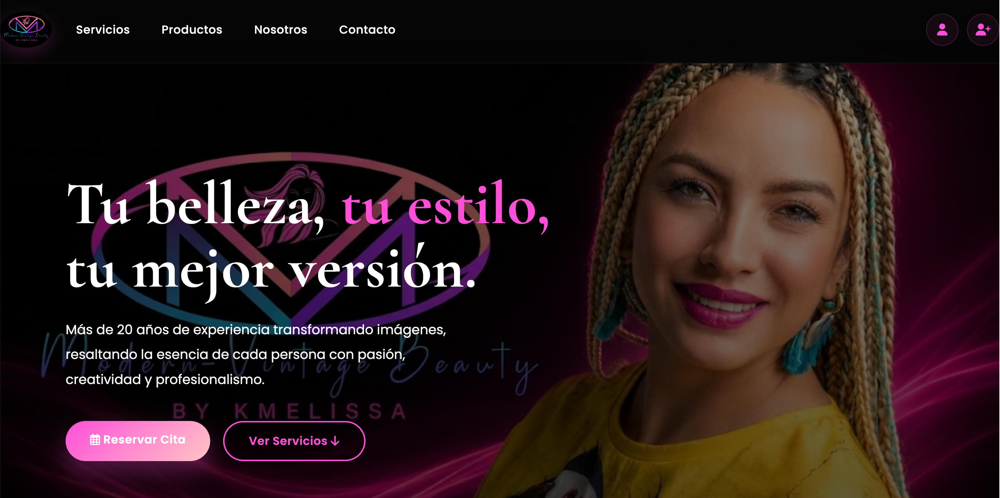
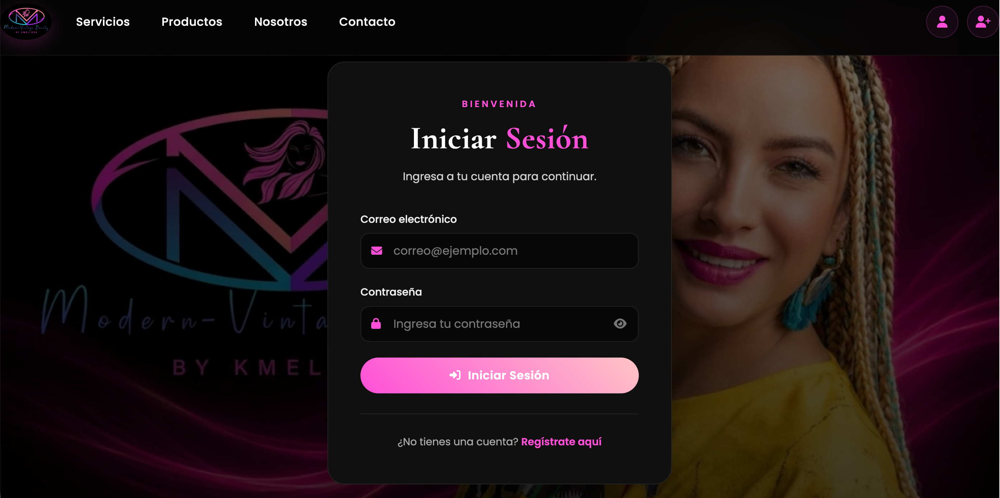
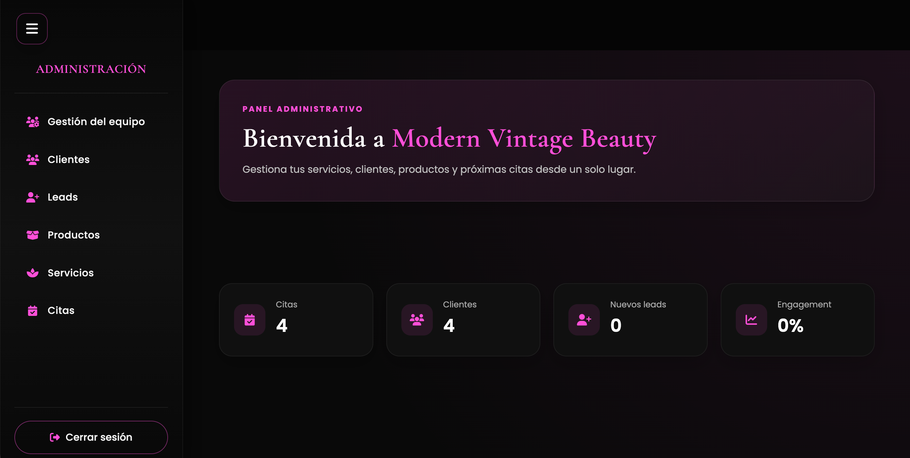

 <div align="center">

# 🌸 Hi, I'm Manuela Muñoz

### 💻 Full Stack Web Developer | MEAN Stack

I'm a Full Stack Web Developer specializing in the MEAN stack, with professional experience in Quality Assurance, Operations and Customer Support.

I build responsive web applications by combining frontend development, backend logic, database integration and user-centered design.


📍 Bogotá, Colombia

[LinkedIn](https://www.linkedin.com/in/manuela-pacheco-munoz-web-developer/) · [Email](mailto:manupa1819@gmail.com)

</div>

---

## 🩷 Tech Stack

<div align="center">


</div>

### Frontend
- HTML5
- CSS3
- JavaScript
- TypeScript
- Angular
- Bootstrap
- Responsive Web Design

### Backend
- Node.js
- Express.js
- REST APIs
- MVC Architecture
- CRUD Operations
- Session-based Authentication
- Access Control

### Database
- MongoDB
- Mongoose

### Development Tools
- Git and GitHub
- Visual Studio Code
- Postman
- MongoDB Compass

---

## 🚀 Featured Project

### 🌸 Modern Vintage Beauty

**A full-stack web application for a beauty business, featuring a public website and private management areas.**

Modern Vintage Beauty is a full-stack project developed as part of my Full Stack Web Development program. It connects an Angular frontend to a Node.js and Express backend, with MongoDB for persistent data storage.

The application brings together business information, client management, products, services, appointments and incoming leads in one system.

### ✨ Key Features

- 🏠 Public-facing business website
- 🔐 User registration, login and session management
- 👤 Private administrative and client areas
- 👥 Client management
- 👩‍💼 Team management
- 💅 Service catalog and management
- 🛍️ Product catalog and management
- 📅 Appointment management
- 📩 Contact and lead management
- 📊 Administrative dashboard with dynamic data
- 🖼️ Product and service image uploads
- 🗄️ MongoDB database integration
- 🔌 Frontend-to-backend communication through REST APIs

### 🧰 Technologies

`Angular` `TypeScript` `Node.js` `Express.js` `MongoDB` `Mongoose` `Bootstrap` `JavaScript` `HTML5` `CSS3`

### 🔗 Project Links

- **Frontend Repository:** [Modern Vintage Beauty Web App](https://github.com/ellafae/modernvintagebeautywebapp)
- **Backend Repository:** [Modern Vintage Beauty Backend](https://github.com/ellafae/backendmvb)

### 🏗️ Architecture

The application follows a client-server architecture with separate frontend, backend and database responsibilities.

```text
User
  |
  v
Angular Frontend
  |
  | HTTP Requests / JSON
  v
Node.js + Express API
  |
  v
Controllers
  |
  v
Mongoose Models
  |
  v
MongoDB Database
```

- **Frontend:** Angular manages the interface, navigation, forms and API communication.
- **Backend:** Node.js and Express handle HTTP requests and expose REST endpoints.
- **Controllers:** Process requests, perform validations and return responses.
- **Models:** Define and manage application data through Mongoose.
- **Database:** MongoDB stores persistent application data.
- **Authentication:** Sessions and middleware protect private areas and restrict access.

### 📸 Application Preview

Here is a preview of Modern Vintage Beauty, including the public homepage, login interface and private administrative area.

<div align="center">

#### 🏠 Homepage



<br/>

#### 🔐 Login



<br/>

#### 📊 Admin Zone



</div>

---

## 💻 Other Projects

### 📦 Products CRUD

A product management application developed to practice frontend development, data operations and CRUD functionality.

**Technologies:** JavaScript · HTML5 · CSS3

### 👥 Clients CRUD

A client management application focused on backend development, data handling and structured application logic.

**Technologies:** Node.js · Express.js · MVC Architecture

---

## 🧪 Quality Assurance & Software Testing

My professional background in Quality Assurance and Operations influences the way I approach software development.

I value reliable functionality, clear requirements, attention to detail and continuous improvement.

### Areas of Interest

- Functional testing
- Test case design
- Requirements analysis
- Bug identification and reporting
- Edge-case analysis
- Regression testing
- Debugging and troubleshooting
- User experience validation
- Process improvement

I believe good software is not only about implementing features. It is also about validating behavior, anticipating potential issues and delivering reliable solutions.

---

## 💼 Professional Experience

Before focusing on Full Stack Development, I gained professional experience in **Quality Assurance, Reporting, Operations and Customer Support**.

These roles helped me develop transferable skills that I bring to technology projects:

- Analytical thinking and attention to detail
- Quality monitoring and performance analysis
- Problem-solving and troubleshooting
- Documentation and process improvement
- Communication and collaboration
- Team coordination and leadership
- Understanding user needs and service quality

My goal is to combine my technical knowledge and professional experience to contribute to development teams that value quality, collaboration and practical problem-solving.

---

## 🤝 Let's Connect

<div align="center">

<a href="https://www.linkedin.com/in/manuela-pacheco-munoz-web-developer/">
  
</a>
&nbsp;&nbsp;&nbsp;
<a href="mailto:manupa1819@gmail.com">
  
</a>

<br/><br/>

💼 Open to opportunities in Full Stack Development and Quality Assurance.

</div>

---

## 🌸 Beyond Coding

- 💃 Professional dancer
- 🎮 Gamer
- 🎨 Design enthusiast
- 🌎 English C1
- 📚 Lifelong learner

---

## 📚 Learning Journey · 2026

Currently completing my Full Stack Web Development program, with a planned completion date of **November 12, 2026**.

My focus is on strengthening my practical skills through application development and continuous learning.

- ✅ HTML5 and CSS3
- ✅ JavaScript and TypeScript
- ✅ Responsive Web Design
- ✅ Bootstrap
- ✅ Git and GitHub
- ✅ Angular
- ✅ Node.js and Express.js
- ✅ MongoDB and Mongoose
- ✅ REST APIs
- ✅ MVC Architecture
- ✅ CRUD Applications
- ✅ Authentication and Sessions
- 🔄 Full Stack Project Development
- 🎯 Program completion: November 12, 2026

---

## 📊 GitHub Overview

<div align="center">


<br/><br/>


</div>

---

<div align="center">

### 💗 Thanks for visiting my profile!

**Building with purpose, learning with curiosity, and improving one project at a time.** 🌸

</div>
