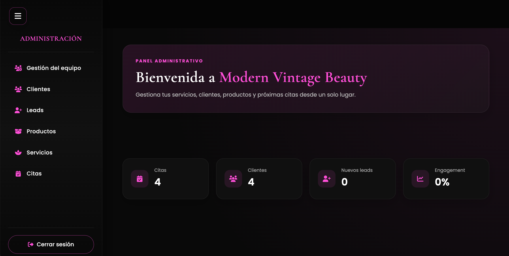

 <div align="center">

# 🌸 Hi, I'm Manuela Muñoz

### Frontend Developer | Angular & TypeScript | QA & Software Testing

**Building functional, accessible and user-centered web applications with a quality-first mindset.**


📍 Bogotá, Colombia

🌎 English: C1

[LinkedIn](https://www.linkedin.com/in/manuela-pacheco-munoz-web-developer/) · [Email](mailto:manupa1819@gmail.com) · [Portfolio Project](https://modernvintagebeauty.mel-ve.com)

</div>

---

## 🩷 About Me

I'm a **Frontend Developer with a background in Quality Assurance, Software Testing and Operations**, passionate about creating functional, responsive and visually engaging web applications.

I have completed my Full Stack Web Development training and gained hands-on experience building and deploying a complete web application, from frontend development and backend integration to database management, testing and production deployment.

My technical focus is **Frontend Development, particularly Angular, TypeScript, JavaScript, HTML5 and CSS3**, complemented by practical experience in software testing and backend development.

Before transitioning into software development, I worked in Quality Assurance, Reporting and Operations, where I developed strong analytical skills, attention to detail, problem-solving abilities and a quality-oriented mindset.

I believe great software requires more than writing code. It requires understanding users, validating functionality, identifying potential issues and delivering reliable solutions.

**My goal is to combine development and quality assurance to build better software and contribute to teams that value clean interfaces, reliable functionality and continuous improvement.**

---

## 💻 Technical Skills

### 🎨 Frontend Development

<div align="center">


</div>

- HTML5 and semantic markup
- CSS3 and custom styling
- JavaScript (ES6+)
- TypeScript
- Angular
- Angular Components, Services and Routing
- Reactive forms and form validation
- HTTP Client and REST API integration
- Responsive Web Design
- Bootstrap 4.6
- Dynamic data rendering
- User Interface Development
- Frontend architecture and component-based development

### 🧪 Quality Assurance & Software Testing

<div align="center">


</div>

- Unit Testing
- Angular Testing with Jasmine and Karma
- Test case design and execution
- Functional Testing
- API Testing with Postman
- Integration Testing
- Requirements Analysis
- Bug Identification and Reporting
- Regression Testing
- Edge-case and validation testing
- Debugging and Troubleshooting
- Test coverage and quality validation
- User Experience Validation
- Continuous Improvement

### ⚙️ Backend Development

<div align="center">


</div>

- Node.js
- Express.js
- RESTful API Development
- MVC Architecture
- CRUD Operations
- Middleware
- Session-based Authentication
- Role-based Access Control
- Password Encryption with bcrypt
- Email Services with Nodemailer
- File Uploads with Multer
- Server-side Validation

### 🗄️ Databases

<div align="center">


</div>

- MongoDB
- Mongoose
- Database Modeling
- Schema Validation
- Data Relationships and Management
- CRUD Database Operations

### 🚀 Deployment & Development Tools

<div align="center">


</div>

- Git and GitHub
- Visual Studio Code
- Postman
- MongoDB Compass
- npm and Node Package Management
- Linux / Ubuntu Server
- SSH and Remote Server Administration
- PM2 Process Management
- Application Deployment
- Production Environment Configuration
- Environment Variables
- Frontend and Backend Integration

### 📊 Additional Technologies

- Chart.js
- Font Awesome
- JSON
- HTTP
- Bootstrap
- REST API Architecture
- Session Management
- Nodemailer

---

## 🚀 Featured Project

# 🌸 Modern Vintage Beauty

### Full Stack Web Application | Live Production Deployment

**A complete web application developed for a beauty business, combining a public-facing website with private administrative and client management systems.**

<div align="center">

<a href="https://modernvintagebeauty.mel-ve.com">


**🌐 LIVE APPLICATION: modernvintagebeauty.mel-ve.com**

</a>

[Visit Website](https://modernvintagebeauty.mel-ve.com) · [Frontend Repository](https://github.com/ellafae/modernvintagebeautywebapp) · [Backend Repository](https://github.com/ellafae/backendmvb)

</div>

### 📌 Project Overview

Modern Vintage Beauty is a production-ready web application developed as my final Full Stack Web Development project.

The application was built using Angular for the frontend, Node.js and Express.js for the backend, and MongoDB for persistent data storage.

The project includes a responsive public website, user authentication, private management areas, appointment scheduling, product and service catalogs, customer management and administrative reporting.

Beyond development, I configured and deployed the application to a remote Ubuntu server, managed the backend process with PM2 and made the application publicly accessible through its production domain.

This project allowed me to work through the complete development lifecycle: planning, implementation, frontend and backend integration, database configuration, testing, server setup, deployment and production validation.

### ✨ Main Features

**Frontend & User Experience**
- Responsive public business website.
- Dynamic product and service catalogs.
- Angular component-based architecture.
- Navigation and routing.
- Form handling and validation.
- Integration with backend REST APIs.
- Private client and administrator interfaces.
- Dynamic administrative dashboard.
- Data visualization with Chart.js.

**Authentication & Security**
- User registration and login.
- Password hashing with bcrypt.
- Session-based authentication.
- Email verification.
- Password recovery through email.
- Password change functionality.
- Role-based access control.
- Protected backend routes and middleware.
- Separate administrator and client permissions.

**Business Management**
- Client management.
- Employee management.
- Product management and CRUD operations.
- Service management and CRUD operations.
- Appointment scheduling and management.
- Appointment rescheduling and cancellation.
- Contact form and lead management.
- Lead status tracking.
- Administrative statistics and reporting.
- Image uploads for products and services.

**Backend & Database**
- REST API development.
- MVC architecture.
- Express controllers and routes.
- Mongoose models and schemas.
- MongoDB integration.
- Server-side validation.
- File handling with Multer.
- Email functionality with Nodemailer.

**Deployment & Production**
- Remote Ubuntu server configuration.
- SSH access and server administration.
- Node.js application deployment.
- PM2 process management.
- Production environment configuration.
- Public application deployment.
- Frontend and backend production integration.

### 🧰 Technologies Used

`Angular` `TypeScript` `JavaScript` `HTML5` `CSS3` `Bootstrap 4.6` `Node.js` `Express.js` `MongoDB` `Mongoose` `REST APIs` `MVC` `bcrypt` `Nodemailer` `Multer` `Chart.js` `Git` `GitHub` `Linux` `Ubuntu` `PM2`

### 🏗️ Application Architecture

The project follows a client-server architecture with separate frontend, backend and database responsibilities.

```text
                   USER
                     |
                     v
              ANGULAR FRONTEND
              HTML / CSS / TS
                     |
                     | HTTP / JSON
                     v
              NODE.JS + EXPRESS
                  REST API
                     |
                     v
                CONTROLLERS
                     |
                     v
              MONGOOSE MODELS
                     |
                     v
                 MONGODB
```

**Frontend:** Angular handles the user interface, components, routing, forms, navigation and API communication.

**Backend:** Node.js and Express.js handle HTTP requests, business logic, validations and API endpoints.

**Controllers:** Process requests and coordinate application operations.

**Models:** Define data structures and database interactions through Mongoose.

**Database:** MongoDB stores application information persistently.

**Security:** Authentication sessions, password encryption and middleware protect private resources and control access according to user roles.

### 🧪 Testing & Quality Assurance

Quality assurance was an important part of the development process.

I worked with unit testing and application validation to verify component behavior, identify issues and improve application reliability.

Testing tools and practices included:

- Jasmine and Karma for Angular unit testing.
- TestBed and ComponentFixture for component testing.
- HTTP service dependency configuration.
- Router configuration in test environments.
- Test execution and failure analysis.
- Functional validation of application features.
- API testing with Postman.
- Validation of frontend and backend communication.
- Real backend and database integration during testing.

My QA background helped me approach development with a focus on expected behavior, input validation, edge cases and reliable functionality.

### 📸 Application Screenshots

<div align="center">

#### 🏠 Public Homepage


#### 🔐 User Authentication


#### 📊 Administrative Dashboard



</div>

---

## 🧪 Quality Assurance & Professional Background

Before transitioning into software development, I built my professional career in **Quality Assurance, Reporting, Operations and Customer Support**.

I have experience working with quality monitoring, performance indicators, operational processes, reporting, troubleshooting and team coordination.

My professional experience includes:

- Quality Assurance Manager
- Reporting and Back Office
- Customer Support and Technical Support
- Operations and Performance Monitoring
- Team Supervision and Coordination

These experiences shaped the way I approach software development.

### My QA Strengths

- Analytical and critical thinking.
- Attention to detail.
- Requirements understanding and analysis.
- Functional validation.
- Problem identification and investigation.
- Process documentation.
- Performance and quality monitoring.
- Root cause analysis.
- Communication and teamwork.
- Continuous improvement.

I bring a quality-first mindset to development, combining technical implementation with the ability to evaluate whether a solution actually works as expected.

---

## 💼 What I Bring to a Development Team

| Area | My Contribution |
|---|---|
| Frontend Development | Responsive interfaces, Angular components and API integration |
| Software Testing | Unit testing, functional testing and bug identification |
| Quality Assurance | Requirements analysis and quality validation |
| Backend Development | REST APIs, Node.js, Express and MongoDB |
| Problem Solving | Analytical thinking and troubleshooting |
| Operations | Process improvement, reporting and performance monitoring |
| Collaboration | Communication, teamwork and leadership experience |

I am particularly interested in opportunities where I can contribute to frontend development, software quality and testing while continuing to grow as a developer.

---

## 💗 Beyond Coding

- 💃 Professional dancer and creative enthusiast.
- 🎮 Gamer.
- 🎨 Interested in web design and visual experiences.
- 🌎 English proficiency: C1.
- 📚 Always learning and exploring new technologies.

I enjoy combining creativity and technical problem-solving to build applications that are both functional and visually engaging.

---

## 📊 GitHub Overview

<div align="center">


<br/><br/>


</div>

---

## 🤝 Let's Connect!

<div align="center">

I'm open to opportunities in:

**Frontend Development · Angular Development · Quality Assurance · Software Testing**

<br/>

<a href="https://www.linkedin.com/in/manuela-pacheco-munoz-web-developer/">

</a>
&nbsp;&nbsp;
<a href="mailto:manupa1819@gmail.com">

</a>
&nbsp;&nbsp;
<a href="https://github.com/ellafae">

</a>

<br/><br/>

**💼 Let's build reliable, meaningful and beautiful software together.**

</div>

---

<div align="center">

### 🌸 Thanks for visiting my profile!

**Code with purpose. Test with precision. Build with creativity.** 💗

</div>
